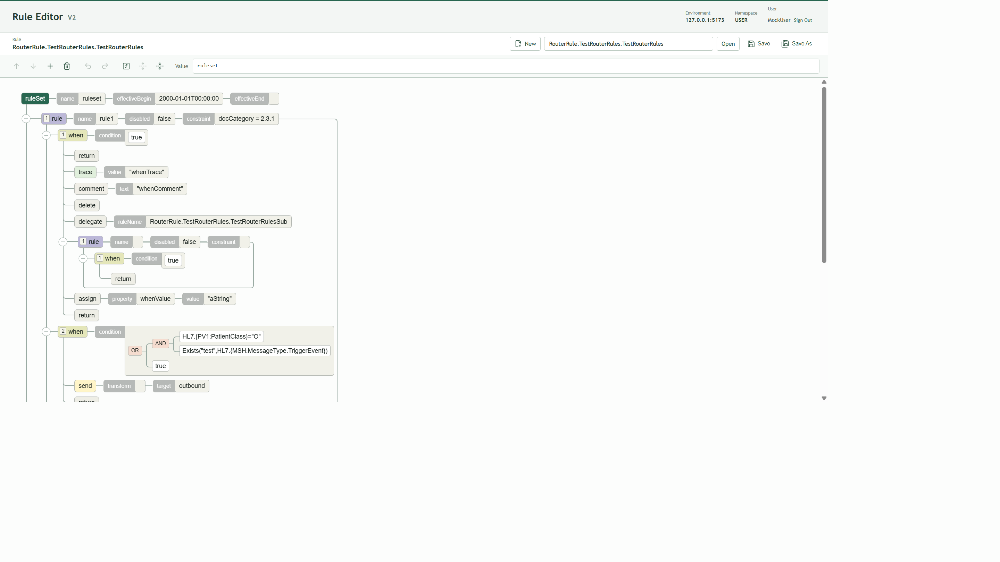
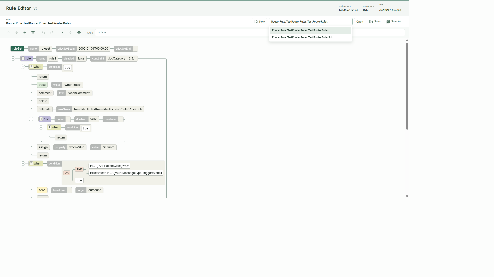
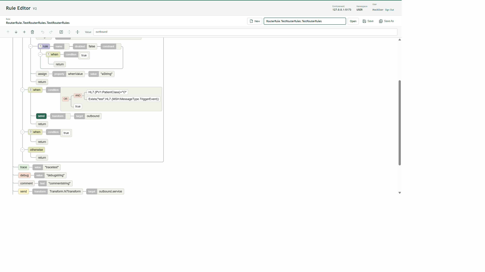

# IRIS Interoperability Tools

Alternative browser UI tools for InterSystems IRIS. The current tool is the
Rule Editor in [rule-editor](rule-editor/README.md), with reusable browser
authentication in [iris-auth](iris-auth/README.md).

## Screenshots

These screenshots show the local mock preview with sample HL7 rule data; they
do not show a live production namespace.



*Editor, environment and user identity, rule selector, and command bars.*



*Searchable dropdown for the available sample rules.*



*A selected send action with Transform displayed before Target.*

## VS Code

Open this repository's root folder in VS Code. Install Node.js 22 LTS or newer
and Microsoft Edge (used by the browser debug configurations). JavaScript and
Node debugging are built into VS Code; the recommended ObjectScript extension
adds editing support for the optional IRIS installer.

Run **Terminal > Run Task > Install Dependencies** once. Available tasks are:

| Task | Result |
| --- | --- |
| Install Dependencies | Reproducible `npm ci` in the editor folder |
| Build Static UI | Production browser assets in `rule-editor/dist/` (default build task) |
| Test | Node test suite (default test task) |
| Package for IRIS | IPM module directory and deployment ZIP in `rule-editor/artifacts/` |

Use **Run and Debug** to select a configuration, then press F5:

| Configuration | Purpose |
| --- | --- |
| Preview: Mock API + Browser | Debug the local server and browser against sample data |
| Preview: Live API + Browser | Debug without mock routes; configure an accessible real API first |
| Browser: Existing IRIS Deployment | Enter a deployed UI URL and debug its browser code |
| Build Static UI | Step through the static builder |
| Package for IRIS | Step through package creation |
| Tests: All | Debug the entire test suite serially |
| Tests: Current File | Debug the active `rule-editor/tests/*.test.mjs` file |
| Attach: Node Inspector | Attach to a process started with `node --inspect` on port 9229 |

Preview configurations open the system default browser at the server's actual
port, even when 5173 is occupied. They debug the local Node server but do not
attach VS Code's debugger to the browser. Stop debugging to stop the preview.
Live preview is static hosting, not an API proxy: use the existing API's
same-origin deployment or configure appropriate CORS. Never add credentials to
launch configurations or commit them to runtime configuration.

## Build And Package

The equivalent commands, from `rule-editor`, are:

```powershell
npm ci
npm test
npm run build
npm run package:iris
```

The package builder creates `artifacts/iris-interop-tools-0.1.0/` (an IPM/ZPM
module with `module.xml`) and `artifacts/iris-interop-tools-0.1.0.zip` (the same
module, assets and standalone ObjectScript installer). Set `PACKAGE_VERSION`
to a semantic version to override `0.1.0`:

```powershell
$env:PACKAGE_VERSION = "1.2.3"
npm run package:iris
```

See [the installation guide](rule-editor/iris/README.md) for IPM and standalone
installation commands. The package creates `/iris-tools/rule-editor`; it does
not include an interoperability backend. IRIS must already expose the compatible
interop-editors API. The package keeps authentication enabled and requires an
explicit `$NAMESPACE` URL parameter rather than shipping a preview fallback.
Node.js is needed only for development/building, not on the IRIS server.

## Dependencies

Install the editor's dependencies from `rule-editor` with `npm ci`. The direct
packages are listed in `rule-editor/package.json`; npm also installs their
transitive dependencies, which support these packages and are not imported by
the application directly.

| Package | Dependency type | Why it is installed |
| --- | --- | --- |
| `@intersystems/iris-auth` | Runtime, local `../iris-auth` package | Provides IRIS session/token authentication, sign-in/out behavior, and its browser UI. The static build includes its browser modules and stylesheet. |
| `chevrotain` | Runtime | Tokenizes and parses rule condition expressions for the condition editor. Its browser module is included in the static build. |
| `lucide` | Runtime | Supplies the icons used by editor, save, and rule actions. Its browser icon bundle is included in the static build. |
| `fflate` | Development | Creates the ZIP archive in `package.mjs` and reads archives in packaging tests. It is not included in the IRIS web assets. |

The preview server and build scripts use Node.js built-in modules, so there is
no separate web-server or bundler dependency. The runtime packages above are
copied into the static build because the browser loads them directly; `fflate`
is only needed on the development/CI machine that creates or tests the ZIP.

## GitHub Actions

[The packaging workflow](.github/workflows/package-iris.yml) runs a clean install,
tests, static build and package build on Ubuntu for pushes and pull
requests. It can also be started manually. Download `iris-interop-tools-zip`
or `iris-interop-tools-ipm` from the workflow run's artifacts.

Push a semantic-version tag such as `v1.2.3` to build version `1.2.3` and create
a GitHub Release with the deployment ZIP attached, after both builds succeed.
No IRIS credentials are required by the workflow; deployment remains an explicit
administrator action. CI validates package contents but does not execute the
installer inside IRIS.